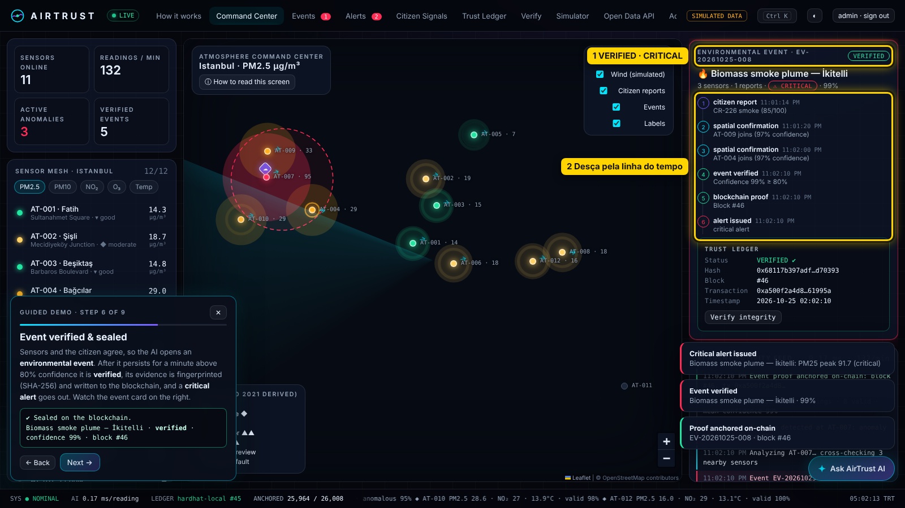
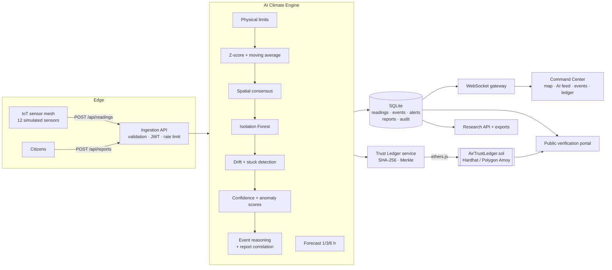
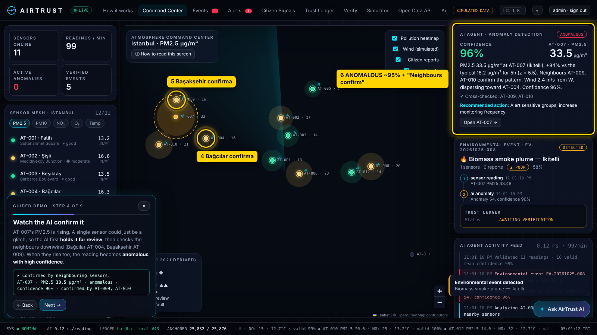
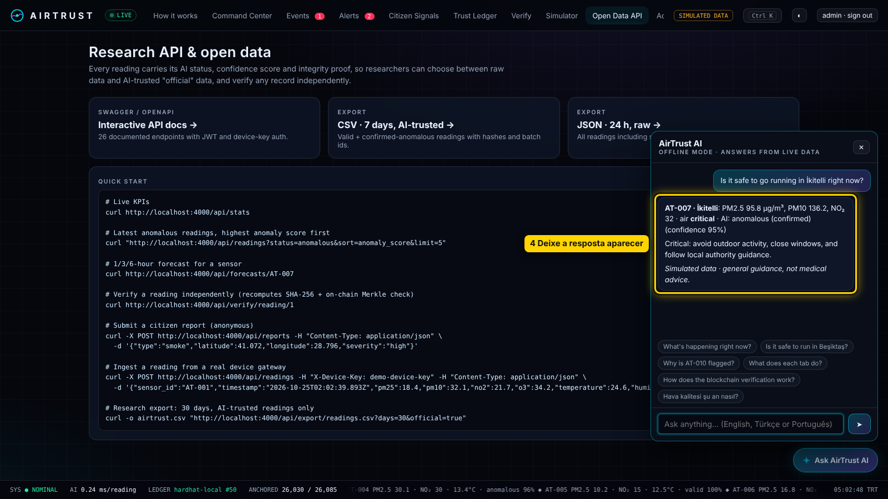
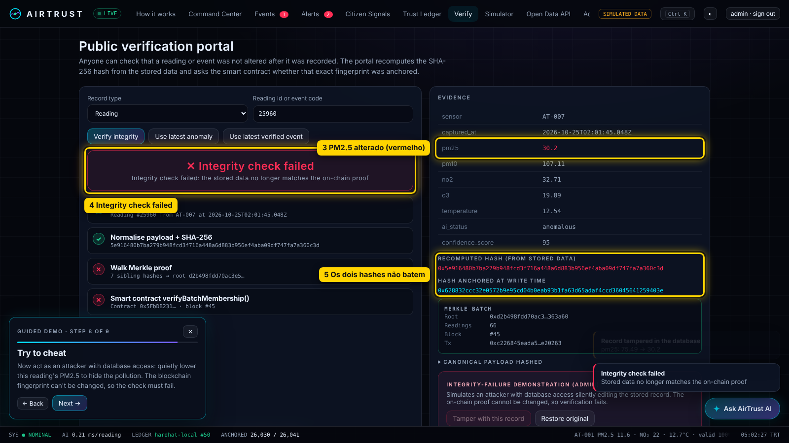

# AirTrust — Climate Intelligence OS

**See the atmosphere. Trust the evidence. Act in time.**

AirTrust turns fragmented environmental signals into **trusted, explainable and verifiable** air-quality intelligence. It combines a low-cost IoT sensor mesh, citizen science, an explainable AI engine and blockchain integrity proofs in a real-time geospatial command center.

> **IEEE ClimateChain Global Hackathon 2026 · Track: Climate Data & Environmental Monitoring**
> *"Enable reliable and accessible climate data systems. Environmental data is fragmented and difficult to verify."*



> 📍 **Pilot city: Istanbul, Türkiye.** The engine is city-agnostic: neighbours, profiles and plumes are computed from each network's own sensor coordinates.

> ⚠️ **All sensor data in this prototype is simulated** (12 virtual sensors at real Istanbul locations) and is labelled as simulated in the UI, the API and every export.

---

## Contents
[Problem](#problem) · [Solution](#solution) · [Track alignment](#track-alignment) · [Architecture](#architecture) · [Quick start](#quick-start) · [Demo credentials](#demo-credentials) · [How the AI works](#how-the-ai-works) · [How the blockchain works](#how-the-blockchain-works) · [API](#api) · [Security](#security) · [Tests](#tests) · [Limitations](#limitations) · [Roadmap](#roadmap)

## Problem

Air pollution is one of the largest environmental health risks; the WHO tightened its PM2.5 annual guideline from 10 to 5 µg/m³ in 2021. Yet monitoring is uneven: reference stations are accurate but expensive and sparse, while low-cost sensors add coverage but raise doubts about **calibration drift, faults, noise and manipulation**. Communities, researchers and agencies need more than raw numbers: they need evidence they can **trust, understand and verify**.

## Solution

| Pillar | What AirTrust does |
|---|---|
| **Sense** | 12-sensor IoT mesh across Istanbul, on both sides of the Bosphorus (PM2.5, PM10, NO₂, O₃, temperature, humidity, wind, battery, signal, firmware) + citizen reports |
| **Understand** | Explainable AI validates every reading, detects anomalies, cross-checks neighbours, forecasts 1/3/6 h and reasons about events |
| **Trust** | SHA-256 fingerprints anchored on-chain: Merkle batches for every reading, individual proofs for verified events and critical readings |
| **Act** | Alerts with recommended actions, public verification portal, open research API and exports |
| **Explain** | A *How it works* page, a 2-minute guided demo and an embedded **AI assistant** that answers questions from live data (EN/PT) |

**The key idea:** AI and blockchain solve two different trust problems.
- The **AI** answers *"is this measurement credible?"* (calibration, faults, glitches, consensus).
- The **blockchain** answers *"has this record been changed since it was recorded?"* (tamper evidence).

Every reading gets two separate scores: **anomaly score** (is something unusual happening in the air?) and **confidence score** (how much do we trust this measurement?). A real pollution event is *high anomaly + high confidence* (neighbours confirm it). A sensor glitch is *high anomaly + low confidence*.

## Track alignment

| Track suggestion | AirTrust |
|---|---|
| Climate data verification platforms | Public verification portal: recomputes SHA-256, walks the Merkle proof and calls the smart contract |
| IoT environmental monitoring | Sensor mesh with health, battery, firmware, drift and offline detection |
| Tools for research and insights | Open REST API (OpenAPI/Swagger), CSV/JSON exports with AI status, confidence and proof per row |
| Climate data marketplaces | Every exported row carries provenance (hash + batch id + tx), the foundation for trusted data exchange |

## Architecture



**Stack:** Node.js 22 (HTTP API + WebSocket via `ws`, built-in `node:sqlite`), Solidity 0.8.24 + Hardhat + ethers v6, vanilla JS + Leaflet front end (no build step), OpenAPI 3 + Swagger UI, `node:test` + Hardhat/Chai tests.

> Why not Next.js/NestJS/Postgres/Python? The brief called for a running prototype within a hackathon window. A single Node runtime with zero native dependencies starts with **one command on Windows, macOS and Linux**, and every algorithm (Isolation Forest, OLS forecasting, Merkle trees) is implemented and tested in the repo instead of hidden behind libraries. The DB layer mirrors the planned Postgres schema and can be swapped module by module.

### Repository layout

```
contracts/AirTrustLedger.sol   Smart contract (reading, event and Merkle batch proofs)
test/                          Hardhat/Chai contract tests
server/
  ai/engine.js                 Explainable validation + anomaly detection
  ai/isolationForest.js        Isolation Forest implementation
  ai/forecast.js               WMA + OLS forecast with confidence intervals
  ai/assistant.js              Embedded assistant (BYOK LLM + offline mode, live data)
  core.js                      Ingestion pipeline, event reasoning, report correlation,
                               alerts, Merkle anchoring, integrity verification
  simulator.js                 IoT mesh + 12 scenarios
  ledger.js                    ethers.js service (deploy, anchor, verify)
  lib/merkle.js, hashing.js    Sorted-pair SHA-256 Merkle + canonical payloads
  auth.js                      JWT (HS256) + scrypt + roles
  index.js                     REST API, WebSocket gateway, static UI
  openapi.js                   OpenAPI 3 spec
scripts/start.js               One-command launcher (compile, chain, seed, server)
scripts/seed.js                30 days of history, 7 historical scenarios, 25 reports
scripts/deploy.js              Deploy to Polygon Amoy
public/                        Command center (index.html, app.js, guide.js, styles.css), Swagger page
tests/backend.test.js          AI, correlation, hashing, Merkle, auth tests
```

## Quick start

Requirements: **Node.js 22.13+** and Git. No Docker, Python or paid services needed. Works offline except for map tiles and web fonts.

```bash
git clone https://github.com/estercpaulino2007/airtrust.git
cd airtrust
npm install
npm start
```

Then open **http://localhost:4000**. First-time visitors get a welcome dialog: choose **Take the 2-minute guided demo** to be walked through the whole story with one click per step.

> **Windows + Node 24:** Hardhat 2 sometimes crashes on exit after compiling (`Assertion failed: !(handle->flags & UV_HANDLE_CLOSING)`). `npm start` tolerates it. If the blockchain itself won't start, use two terminals: `npx hardhat node` in the first, then `npm run seed` and `npm run server` in the second, or install Node 22 LTS.

`npm start` compiles the contract (bundled solc-js, offline), starts a local Hardhat blockchain on `:8545`, seeds 30 days of history on first run (~10 s, includes anchoring 31 Merkle batches and 5 event proofs), and starts the API + command center.

| Command | What it does |
|---|---|
| `npm start` | Everything above |
| `npm run reseed` | Start with a fresh database and chain |
| `npm test` | Contract tests + backend tests |
| `npm run deploy:amoy` | Deploy the contract to Polygon Amoy (see `.env.example`) |

### Environment variables

Copy `.env.example` to `.env` to customise. Defaults work out of the box.

| Variable | Default | Purpose |
|---|---|---|
| `PORT` | `4000` | HTTP port |
| `JWT_SECRET` | dev value | Change in production |
| `DEVICE_KEY` | `demo-device-key` | Header `X-Device-Key` for device gateways |
| `TICK_MS` | `5000` | Simulated reading interval |
| `BATCH_MS` | `30000` | Merkle batch anchoring interval |
| `RPC_URL` | `http://127.0.0.1:8545` | Blockchain RPC |
| `LEDGER_PRIVATE_KEY` / `CONTRACT_ADDRESS` | – | Use an existing deployment (e.g. Polygon Amoy) |
| `ASSISTANT_API_KEY` | – | Optional LLM key for the AI assistant (Groq free tier works). Without it the assistant runs in offline mode |
| `ASSISTANT_API_FORMAT` | `openai` | `openai` (Groq, OpenAI-compatible) or `anthropic` |
| `ASSISTANT_API_BASE_URL` | `https://api.groq.com/openai` | Provider base URL (`https://api.anthropic.com` for Anthropic) |
| `ASSISTANT_MODEL` | `openai/gpt-oss-120b` | Model name |

## Demo credentials

All passwords: **`AirTrust2026!`**

| Role | Email | Can |
|---|---|---|
| Admin | `admin@airtrust.demo` | Everything, admin console, integrity-failure demo |
| Operator | `operator@airtrust.demo` | Trigger scenarios, anchor proofs |
| Researcher | `researcher@airtrust.demo` | Research access |
| Citizen | `citizen@airtrust.demo` | Submit reports (anonymous reports are also accepted) |
| Public | – | Read-only map, verification portal, open data |

## Demo checklist (3–5 min)

> Shortcut: click **Take the 2-minute guided demo** in the welcome dialog (or *How it works → Start guided demo*) and the app walks through steps 2–8 for you.

1. **Boot** → mission-control sequence checks sensors, AI engine and ledger.
2. **Command Center** → live map, 11/12 sensors online (AT-011 offline), AT-010 flagged for calibration drift.
3. **Sign in as admin** → *Scenario Simulator* → **Localized burning event**.
4. Watch AT-007 (İkitelli industrial zone) rise; the AI first **holds it for review**, then Bağcılar (AT-004) and Başakşehir (AT-009) confirm and it becomes **anomalous at ~95% confidence** with an explanation.
5. **Citizen Signals** → send a *Smoke* report near İkitelli (default pin) → **strong correlation**.
6. After ~60 s the event is **verified**, hashed, **anchored on-chain**, and a **critical alert** is issued. Timeline: reading → AI anomaly → spatial confirmation → citizen report → verified → blockchain proof → alert.
7. **Verify** → *Use latest anomaly* → ✔ hash ✔ Merkle proof ✔ smart contract.
8. **Tamper with this record** → the database value changes → **✕ Integrity check failed**. *Restore original* → verified again.
9. **Scenario Simulator** → *Faulty sensor* → AT-012 becomes `sensor_fault`, excluded from averages, maintenance alert.
10. **Research API** → Swagger docs, CSV export with AI status and proof per row.

## Onboarding & AI assistant



- **How it works** tab: what AirTrust is and who it's for, the 5-step pipeline, what every tab does, how to read the map, a glossary and the demo accounts.
- **Guided demo** (2 minutes, 9 steps): every step has a *do it for me* button and waits for the live system (e.g. "wait until neighbours confirm the fire"), ending with the tamper demo.
- **"How to read this screen"** help on the command center.
- **Ask AirTrust AI** (✦ button, bottom right): answers questions like *"Is it safe to run in Beşiktaş?"*, *"Why is AT-010 flagged?"*, *"What does each tab do?"* in English, Turkish or Portuguese, grounded in a live snapshot of sensors, events, alerts, reports and ledger status.
  - **LLM mode** (bring-your-own-key): set `ASSISTANT_API_KEY` (e.g. a free [Groq](https://console.groq.com) key). The model receives the live snapshot and is instructed to answer only from it, never inventing data.
  
  - **Offline mode** (default, no key): a deterministic assistant (English/Portuguese) answers from the same live data, so the feature works for anyone who clones the repo. If the LLM provider fails, it falls back automatically.

## How the AI works

Every reading passes through seven checks (`server/ai/engine.js`), all reported in the UI:

| Method | Detects | Effect |
|---|---|---|
| Physical limits | Impossible values | `invalid` |
| Z-score vs 24 h history | Extreme deviation | anomaly score |
| Moving-average deviation | Abrupt jumps | lowers temporal confidence |
| Hour-of-day profile (30 days) | Unusual for this time | relative level, explanation |
| Spatial consensus (nearest 3–5 sensors) | Isolated vs shared signal | confirms events or flags glitches |
| Zero variance | Frozen firmware | `sensor_fault` |
| Calibration drift (sensor/neighbour ratio vs calibration period) | Slow degradation | `suspicious` + maintenance alert |
| Isolation Forest (7 features, 100 trees) | Multivariate outliers | anomaly score |

**Confidence score** (research dossier §5.3):
`0.35 × temporal + 0.30 × spatial + 0.20 × physical + 0.15 × sensor_health`

**Classification:** `valid` · `anomalous` (unusual and corroborated) · `suspicious` (unusual but uncorroborated, or drifting) · `sensor_fault` · `invalid`. Only `valid` and `anomalous` readings enter official averages and the "official" export.

**Event reasoning** (`server/core.js`) groups corroborated anomalies within 8 km into environmental events and classifies them from the pollutant signature: PM2.5/PM10 ratio (combustion vs dust), NO₂ with sensor context (traffic vs industrial), heat + stagnant wind (heatwave). Event confidence combines reading confidence, number of confirming sensors and citizen-report correlation; an event is **verified at ≥ 80%** after persisting ≥ 60 s, otherwise it is **dismissed** when it fades.

**Citizen-report correlation** scores 0–100 from distance (25), timing (15), pollutant increase (30), wind direction (10), neighbour confirmation (10) and severity alignment (10).

**Forecast** (`server/ai/forecast.js`): blend of weighted moving average and OLS with trend, daily cycle (sin/cos) and neighbour mean, plus decay of the current anomaly; 1/3/6 h horizons with 95% intervals.

## How the blockchain works



`contracts/AirTrustLedger.sol` stores **fingerprints, never raw data**:

| Proof | When | Why |
|---|---|---|
| `BatchProof` (Merkle root) | Every 30 s, all new readings | One transaction covers hundreds of readings; each reading stays individually provable with its Merkle path. Verified **on-chain** by `verifyBatchMembership()` |
| `EventProof` | When an event is verified | Tamper-evident record of the event type, severity, sensors, reports and confidence |
| `ReadingProof` | Peak reading of each verified event | Critical evidence anchored individually |

Rules: authorised submitters only, unique hashes (duplicates revert with `DuplicateHash`), events emitted for every proof.

**Integrity flow:** normalise payload → SHA-256 → anchor → store tx hash and block → the public portal later recomputes the hash from the stored data and asks the contract. Match → *Data integrity verified*. Mismatch → *Integrity check failed*.

What the blockchain does **not** do: it does not make a sensor more accurate, validate calibration or replace institutional audits. That is the AI's and the operators' job, and why AirTrust uses both.

Runs on a local Hardhat chain by default; `hardhat.config.js` and `npm run deploy:amoy` prepare **Polygon Amoy** without depending on it.

## API

Interactive docs at **http://localhost:4000/docs.html** (OpenAPI JSON at `/api/openapi.json`). Highlights:

```
GET  /api/health                 GET  /api/stats
GET  /api/sensors[/:id[/health|/history]]
POST /api/readings               GET  /api/readings?sensor=&status=&from=&to=&sort=&page=&limit=
GET  /api/anomalies              GET  /api/alerts?status=active
GET  /api/forecasts/:sensorId    GET  /api/events[/:id]
POST /api/reports                GET  /api/reports
POST /api/blockchain/proofs      GET  /api/blockchain/proofs
GET  /api/verify/reading/:id     GET  /api/verify/event/:id
GET  /api/scenarios              POST /api/scenarios/:id/trigger
GET  /api/export/readings.csv    GET  /api/export/readings.json
GET  /api/admin/overview         PUT  /api/admin/thresholds/:pollutant
WS   /ws  (readings, ai, event, alert, proof, report)
```

## Security

- JWT (HS256) with expiry; passwords hashed with **scrypt**; five roles (`public` < `citizen` < `researcher` < `operator` < `admin`).
- Device ingestion via `X-Device-Key` or operator token.
- Input validation on every write, payload size limits, per-IP **rate limiting**, CORS.
- Parameterised SQL everywhere (no string-built queries with user input).
- **Audit log** for logins, scenario triggers, reports, anchoring and tamper demos.
- **Privacy-preserving reports:** location rounded to ~110 m, no contact data stored with a report, anonymous submission allowed.
- Simulated data is labelled in UI, API responses and exports.
- The `/api/demo/tamper` endpoint exists only to demonstrate integrity failure; it is admin-only and audited. Remove it in production.

## Tests

```bash
npm test
```

- **9 contract tests** (Hardhat/Chai): proofs, events, duplicates, zero hash, unauthorised submitters, on-chain Merkle membership, totals.
- **13 backend tests** (`node:test`): ingestion validation, invalid readings, burning event with spatial consensus and verification, isolated spike held as suspicious, stuck sensor fault, calibration drift, citizen-report correlation, forecast intervals, hash sensitivity, Merkle proofs, JWT and roles, Isolation Forest, offline assistant (EN/PT, live data).

## Limitations

- Sensor data is simulated; plume dispersion is a simple distance/wind model, not an atmospheric model.
- Thresholds are derived from WHO 2021 guidelines and configurable, not a legal air-quality index.
- Single-node SQLite; production would use Postgres/TimescaleDB.
- The ledger signer is a server key; production would use per-gateway keys and a public testnet/mainnet.
- Forecasting is statistical (no meteorological model).

## Roadmap

1. Real low-cost sensor gateways (MQTT) and OpenAQ and Türkiye's national air-quality monitoring network (havaizleme.gov.tr) reference stations for collaborative calibration.
2. Per-device signing keys (hardware-rooted) so readings are signed at the edge.
3. Satellite fire and aerosol layers; meteorological dispersion models.
4. SMS / push alerts and a mobile citizen app with photo evidence.
5. City federation and a verifiable environmental-data marketplace.
6. Water quality, noise, urban heat and wildfire modules on the same trust layer.

## References

WHO Global Air Quality Guidelines (2021) · WHO ambient air pollution fact sheet · WMO and UNEP on low-cost sensors · Nature *npj Climate and Atmospheric Science* (2025) on low-cost sensor trends · Springer on low-cost sensor performance and IoT–blockchain environmental monitoring · OpenAQ API documentation. Full links in `docs/SOURCES.md`.

## License

MIT
